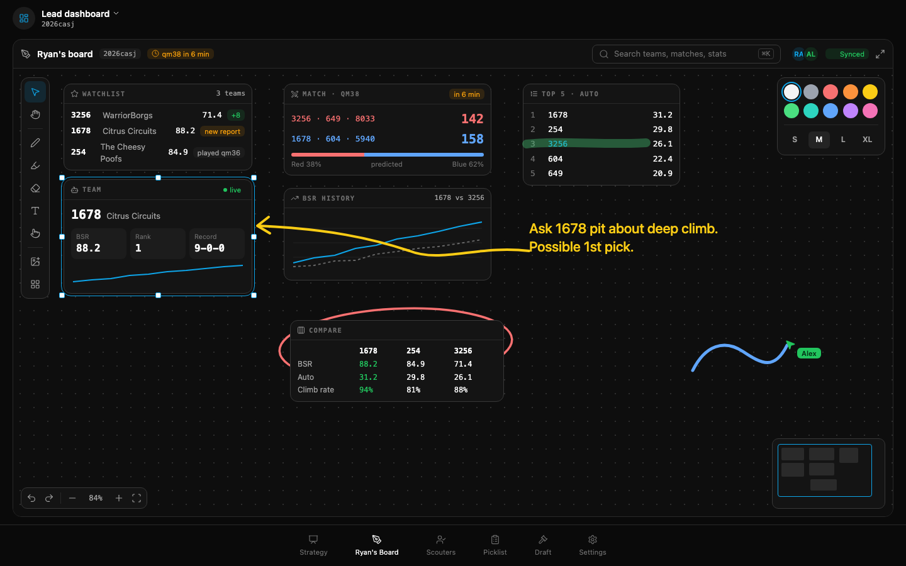
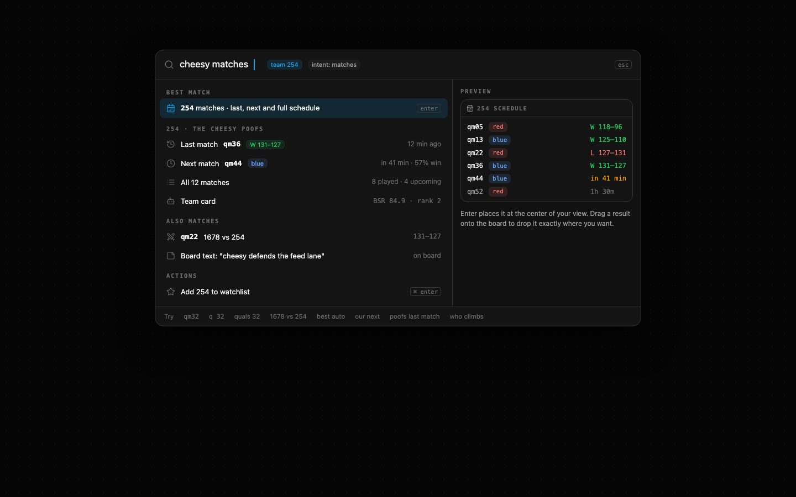
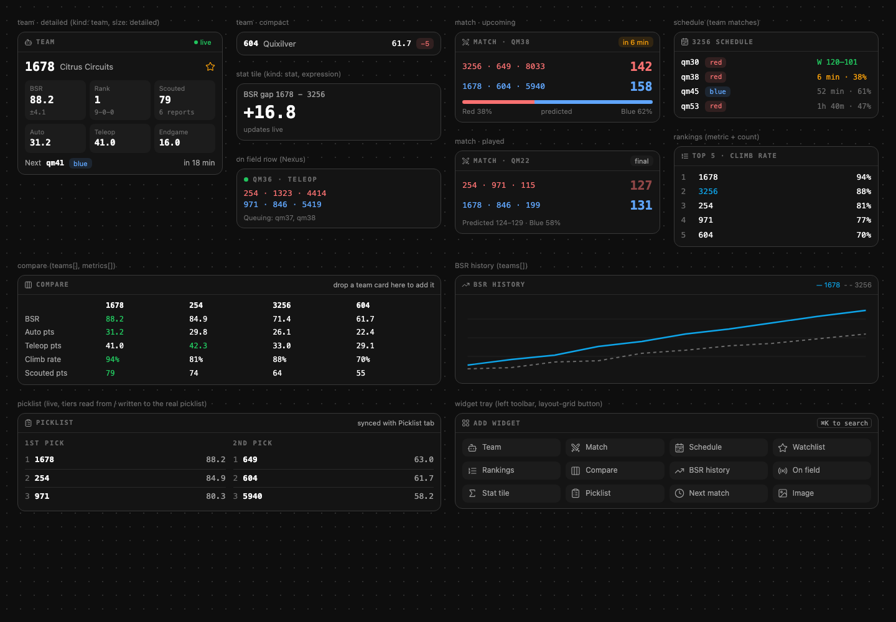
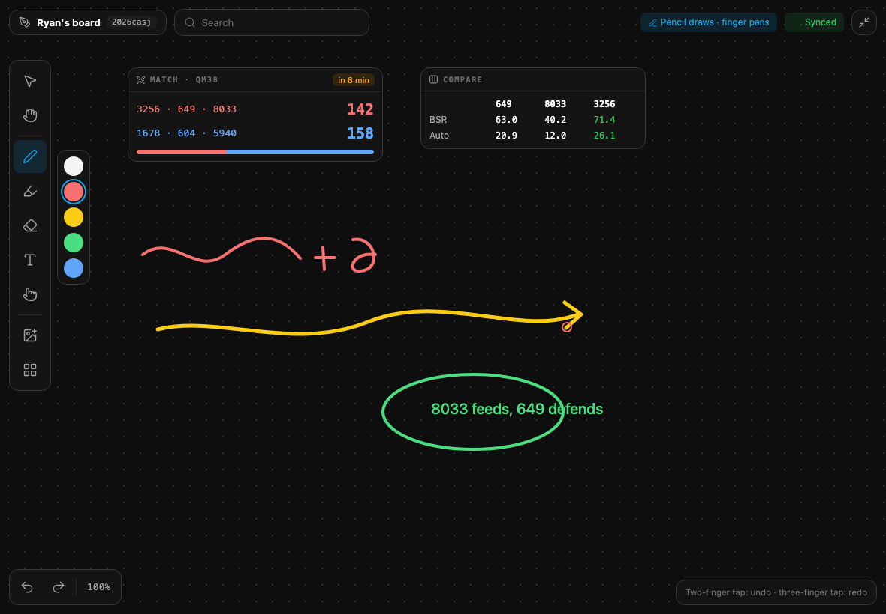

# Ryan's Board: implementation plan and hand-off

Last updated: 2026-10-19. This is the single source of truth for the feature. If you are an
agent picking this up mid-way, read **0. Hand-off state** first, then the section for the
phase you are resuming.

---

## 0. Hand-off state

**Where things stand** (update this block every time a phase lands):

| Phase | What | Status |
| --- | --- | --- |
| P0 | Plan, mockups, decisions | done (`d379820`) |
| P1 | Own canvas engine: ink, text, image, select/move/resize, pan/zoom, undo, local save | done (`517ee74`) |
| P2 | Cloud sync (migration + RPC + outbox) | done and deployed (`905ea3f`); image assets now upload from the durable outbox |
| P3 | Live multiplayer (realtime records, cursors, live ink, laser, drag previews, presence) | done, including follow-a-person viewport and remote selection outlines |
| P4 | Live data widgets | done (`2005122` plus completion changes) |
| P5 | Smart spotlight search (+ test corpus) | done; all 114 query tests pass |
| P6 | Comments, export, polish, e2e | implemented and browser-checked; isolated and dedicated-remote e2e specs added (remote suite not run here) |

**Verified in the browser (2026-10-19)**: pen, highlighter, text, select/move, eraser, wheel
pan, reload persistence (shapes and camera); a stroke drawn in tab A appears in tab B within
3s; tab B sees tab A's cursor and its in-progress stroke live; presence avatars. In dev the
editor is exposed as `window.__ryansBoard` for debugging and e2e.

**Completion verification (2026-10-19)**:
- `npm test`: 185 files / 2,085 tests passed. Type checking and the production build passed.
- Browser: live team/schedule search with preview; offline widget insertion, comment reply and
  resolve/reopen, ink and reload (including an immediate reload after drawing); PNG download
  inspected with ink, comment and widget included; presentation entry/exit; two real Supabase
  tabs following a collaborator's zoom and stopping when navigating locally.
- `board-assets`: anonymous upload and public readback verified against the deployed bucket;
  the synthetic verification image was removed afterward. No backend migration was needed.
- Regression coverage now includes comment serialization/undo, export selection bounds,
  comparison drops, image upload failures and retries, remote ink and record delivery,
  collaborator viewports, and deletion tombstones surviving reload/stale updates.
- Browser fixtures use a synthetic event with networking disabled. Their records are marked
  synced locally so they never enter the real app's global outbox. `npm run test:board` runs
  the isolated desktop/iPad browser spec. `tests/e2e/ryans-board.spec.ts` is the remote two-tab
  spec and retains the existing dedicated-project safety gate. Neither Playwright suite was
  run here; the browser paths above were exercised with the current browser controller.
- Physical Pencil input and the 300-shape frame-rate target have not been measured here.
  The complete board chunk, including widgets/search/export, is about 46 KB gzipped.
- Local changes are committed without pushing, per the hand-off rule below.

**Implementation notes discovered while building**
- Keyboard shortcuts are window-level (`BoardCanvas` attaches keydown/keyup on `window`,
  skipping inputs/textareas/dialogs), because on first load focus sits on `<body>`.
- A text box opened by a click must keep focus: `BoardCanvas` prevents the default
  mousedown while `editingId` is set, otherwise the canvas steals focus and the textarea
  blur-commits empty (and the typed letters fire tool shortcuts).
- `editor.pointerUp` applies the release position before finishing (synthetic drags and fast
  flicks deliver the final point only with pointerup).
- Client id is **per tab** (`device id` + per-load suffix, `persistence.ts boardClientId`), so
  two tabs on one device are distinct collaborators.
- The project does not auto-grant new tables: `20261019121000_board_record_grants.sql`
  grants select. Without it, reads fail with "permission denied for table".
- Local rows that no longer parse (e.g. from the tldraw prototype) are hard-deleted on load
  (`loadBoardRecords`), so they never reach the outbox.
- The in-progress stroke carries the id its ink shape will get (`live.stroke.id`), so remote
  previews disappear exactly when the record lands.

**History of decisions that changed course**
- 2026-10-18: P1 was first built on tldraw 5.5.2. The user rejected it (watermark plus a
  production license key; without a key tldraw hides the editor 5 seconds after load) and
  asked for our own engine, built from the Strategy-tab whiteboard. tldraw and
  `@tldraw/assets` are uninstalled and the Vite `optimizeDeps` workaround was removed.
  Do not reintroduce tldraw.
- 2026-10-18: The user cut scope: **no geometric shapes, no arrow tool, no sticky notes, no
  frames.** The board has ink (pen and highlighter), eraser, text, images, laser pointer,
  and live data widgets. Arrows are drawn by hand with the pen.

**Rules for whoever continues**
- Commit locally with focused commits; **never `git push`** until the user says so (pushing
  to `main` deploys to production on Vercel).
- After any `supabase/` change, deploy it (standing instruction): `npx supabase db push`.
  If CLI function deploys return 401, use the Supabase connector.
- Another Claude session edits files in this same folder (for example `src/dash/AnalysisScreen.tsx`,
  `tests/e2e/alliance-simulator.spec.ts`). **Stage only Ryan's Board files by explicit path**,
  never `git add -A`.
- No emojis in UI strings (lucide icons only). Keep meaningful data color (alliance red/blue,
  good/bad values in green/red), since minimal does not mean grayscale.
- Reuse existing code before writing new code, and treat performance as a feature.
- New npm packages must be vetted by an agent before install. The plan below needs **none**:
  it reuses `perfect-freehand`, already a dependency.

**Files already in place**
- `src/db/types.ts`: `LocalBoardRecord` row type.
- `src/db/localStore.ts`: Dexie **version 6** adds `boardRecords: 'key, boardKey, syncState'`
  plus `boardRecordKey`, `getBoardRecords(boardKey)` and `writeBoardRecords(boardKey, puts, removedIds)`.
  Every write lands with `syncState: 'dirty'`; removals are tombstones (`deleted: true, data: null`).
- `src/db/__tests__/boardRecords.test.ts`: covers the store and the v5 to v6 upgrade.
- `src/dash/DashboardScreen.tsx`: `board` tab ("Ryan's Board", lucide `Shapes` icon), lazy-loaded
  `RyansBoard` and the URL alias `?tab=ryan`. `src/dash/__tests__/DashboardScreen.test.tsx` expects
  the new tab order.
- `src/dash/board/model.ts`: own-engine ink, text, image, widget and comment records.
- `src/dash/board/RyansBoard.tsx`: own-engine host, widgets, spotlight, comments, PNG export
  and presentation mode. No tldraw dependencies remain.

---

## 1. Goal and decisions

Ryan's general dashboard: an infinite board per event where he pins live data about teams
he's tracking, compares teams for the picklist, and annotates freely with the Apple Pencil
or a mouse. Everything syncs to the cloud and updates live across devices.

| Question | Answer |
| --- | --- |
| Who uses it | Ryan's personal board; anyone can view and edit it (login-less app model) |
| How many boards | Exactly one per event (`board_key = event_key`) |
| Devices | Laptop (mouse, trackpad, keyboard) and iPad with Apple Pencil, both first-class |
| Engine | Our own, no third-party canvas library |
| Content types | ink (pen, highlighter), text, image, widget |
| Not wanted | geo shapes, arrow tool, sticky notes, frames |
| Live | Records sync through Supabase; cursors, in-progress ink and laser go over realtime broadcast |
| Search | Spotlight on Cmd/Ctrl+K: very smart, many phrasings map to one thing, mixed queries like "254 matches" answer the obvious question |
| Extras | Comments, watchlist, picklist widget, PNG export, present/laser |

## 2. Mockups

The source HTML for every image lives next to it in `docs/plans/ryans-board/mockups/`
(shared tokens in `mock.css`, which mirrors `src/index.css` `.dark`). To re-render one:

```bash
"/Applications/Google Chrome.app/Contents/MacOS/Google Chrome" --headless=new --disable-gpu --hide-scrollbars --virtual-time-budget=4000 --screenshot=$PWD/01-board-overview.png --window-size=1440,900 file://$PWD/01-board-overview.html
```

### 2.1 Board overview (laptop)


- **Top bar** (46px, `border-b`): pen-tool icon, title "Ryan's board", event-key chip
  (mono), a live "qmNN in N min" chip for our next match, the search pill ("Search teams,
  matches, stats", `⌘K`), presence avatars, sync chip (Synced / Saving / Offline, saved on
  device / Sync error), and a full-screen toggle.
- **Left vertical toolbar** (floating panel at top-left of the canvas): select, hand, divider,
  pen, highlighter, eraser, text, laser, divider, image, widgets. The active tool is tinted brand blue.
- **Style panel** (floating, top-right) appears while a drawing tool is active or something
  styleable is selected: 10 color swatches and size S/M/L/XL. Text also gets alignment.
- **Bottom-left**: undo, redo | zoom out, zoom %, zoom in, zoom to fit.
- **Bottom-right**: minimap with the viewport rectangle.
- **Canvas**: dotted grid that pans and zooms with the camera. Widgets are flat cards
  (`panel` bg, 1px border, 12px radius, mono eyebrow header). Ink, text and highlights sit
  on top or underneath by z-order. The selected item gets a brand-blue outline plus 8 square
  handles. Remote cursors have a name tag, and remote in-progress ink shows live.

### 2.2 Spotlight search


Interpretation chips under the input show how the query was understood ("team 254",
"intent: matches"). Results are grouped: Best match, the resolved team's section (last,
next, all matches, team card), Also matches, On this board, Actions. A live preview pane sits
on the right. The footer shows example queries.

### 2.3 Widget gallery


### 2.4 iPad full screen with Pencil


Full screen hides the dashboard chrome. Buttons are 44px. A quick color strip sits next to
the pen. A "Pencil draws · finger pans" chip appears once a pen is detected.

---

## 3. Architecture overview

```
DashboardScreen ──lazy──> RyansBoard (event key)
                            │
     ┌──────────────────────┼─────────────────────────────┐
     │                      │                             │
 BoardEditor (editor.ts)  BoardDataProvider          live.ts (realtime channel)
 plain TS store:          (widgets/data.tsx)          - postgres_changes on board_record
 shapes, camera,          one shared set of            -> editor.applyRemote()
 selection, tool,         queries for all widgets     - broadcast: cursor, ink, laser, drag
 history, gestures        (EPA, matches, agg,          - presence: name, color
     │                     rankings, Nexus)
     │ change events (local / remote)
     ▼
 persistence.ts ──> Dexie boardRecords (dirty) ──> boardSync.ts outbox ──> RPC upsert_board_records
                                                    (driven by useSync + a fast board-local drain)
```

**React binding**: `useBoard(editor, selector)` wraps `useSyncExternalStore`. The editor
replaces objects immutably on change (a new `shapes` Map, a new `camera` object), so selectors
return stable references and components re-render only when their slice changes.

**Rendering layers** (back to front, inside a `relative overflow-hidden touch-none` viewport):
1. `DotGrid`: CSS `radial-gradient` background; `background-size`/`position` follow the camera.
2. **World layer**: a div with `transform: translate(cx, cy) scale(z)` and `transform-origin: 0 0`.
   Every visible shape is an absolutely positioned child in page coordinates, in paint order.
   Widgets are real React components; ink is SVG.
3. **Overlay SVG** (screen space): selection outline and handles, marquee, eraser ring,
   remote selection outlines. Screen space keeps handles a constant size at any zoom.
4. **Live canvas** (screen space `<canvas>`, DPR-scaled): the in-progress local stroke drawn
   incrementally (only new points per frame, the FieldWhiteboard trick), laser trails, and
   remote in-progress strokes.
5. **Cursors layer**: remote cursors with name tags.
6. **UI chrome**: toolbar, style panel, zoom controls, minimap, text editor overlay, spotlight.

---

## 4. Data model (`src/dash/board/model.ts`)

Pure TypeScript, no React or IO. **Remove** `GeoShape`, `ArrowShape`, `StickyShape`,
`FrameShape`, `Terminal`, the arrow geometry helpers (`terminalAnchor`, `clipToRectEdge`,
`arrowEndpoints`, `arrowControl`, `arrowPolyline`, `unbindFrom`, `withArrowBounds`,
`isBindable`), `STICKY_FILL`, `STROKE_WIDTH`, `FillStyle`, `DashStyle`, `GeoKind`, `ArrowHead`,
the frame special cases in `paintOrder`/`topShapeAt`/`shapesInMarquee`, and the geo/arrow
branches in `hitShape`/`translateShape`/`scaleShape`. `liveBounds` becomes `shapeRect`.

### 4.1 Types

```ts
type ColorName = 'white'|'gray'|'red'|'orange'|'yellow'|'green'|'teal'|'blue'|'violet'|'pink';
COLORS: white #f4f4f5, gray #9ca3af, red #f87171, orange #fb923c, yellow #facc15,
        green #4ade80, teal #2dd4bf, blue #60a5fa, violet #c084fc, pink #f472b6
type SizeName = 's'|'m'|'l'|'xl';
INK_SIZE  = { s: 3, m: 5, l: 9, xl: 16 }    // page units (diameter)
FONT_SIZE = { s: 16, m: 22, l: 32, xl: 48 } // page units
HIGHLIGHTER_SCALE = 3.2 (diameter multiplier), HIGHLIGHTER_OPACITY = 0.35

interface ShapeBase { id; x; y; w; h; z: number; rev: number; by: string; locked?: boolean }
InkShape    { type:'ink';    points: [x,y,pressure][] (relative to x,y); color; size; highlighter?: boolean }
TextShape   { type:'text';   text; color; size; align: 'start'|'middle'|'end' }  // w = wrap width, h measured
ImageShape  { type:'image';  src: string /* storage URL or data URL */; naturalW; naturalH }
WidgetShape { type:'widget'; kind: WidgetKind; config: Record<string, unknown> }
type Shape = InkShape | TextShape | ImageShape | WidgetShape;
type BoardRecord = Shape & { deleted?: false } | { id; deleted: true; rev; by };
```

### 4.2 Identity, revisions, merge
- `newShapeId()` = `'s:' + newStrokeId()` (reuse `src/dash/strategy/strokes.ts`).
- `nextRev()` = `nextCanvasGeneration()` (monotonic epoch-ms).
- `by` = per-device client id: `localStorage['ryans-board-client-id']`, created with
  `crypto.randomUUID()` on first use (with a fallback to `newStrokeId()`).
- **Merge rule** (`recordWins(incoming, current)`): a higher `rev` wins; on equal `rev` the
  greater `by` string wins. The RPC applies the exact same rule. Deletes are tombstones with
  their own `rev`, so an undo of a delete writes the record again at a newer rev and wins.
- `parseRecord(raw)` validates anything from Dexie or the network (type in the allowed set,
  finite x/y/w/h/z, numeric rev, string by) and drops anything malformed. Unknown `type`
  values (including legacy geo/arrow/sticky/frame) are dropped.

### 4.3 Geometry helpers (keep)
`rectsIntersect`, `rectContains`, `pointInRect`, `rectFromPoints`, `unionRects`,
`distToSegment`, `pointsBounds`, `shapeRect`, `paintOrder` (sort by z, then id),
`topShapeAt(ordered, p, tol, skip?)`, `shapesInMarquee` (intersecting; ink must have a point
inside or be fully contained), `hitShape` (ink: distance to the polyline within
`tol + diameter/2`; highlighter uses the scaled diameter; everything else is the rect plus tol),
`translateShape`, `scaleShape` (ink scales points; text changes only `w`/`x` and re-measures
`h`; image and widget scale the rect, and images keep their aspect unless Shift is held, since
aspect lock is the default for images).

---

## 5. Editor (`src/dash/board/editor.ts`)

A plain TypeScript class with no React. One instance per mounted board.

### 5.1 State
```ts
shapes: Map<string, Shape>            // live shapes only (immutable replace on change)
order: Shape[]                        // memoized paintOrder(shapes) (recomputed on change)
camera: { x: number; y: number; z: number }   // screen = page * z + (x, y)
viewport: { w: number; h: number }    // canvas size in CSS px (ResizeObserver)
selection: ReadonlySet<string>
tool: 'select'|'hand'|'pen'|'highlighter'|'eraser'|'text'|'laser'
style: { color: ColorName; size: SizeName; highlighterColor: ColorName; align }
editingId: string | null              // text being edited
gesture: Gesture | null               // the current pointer interaction
marquee: Rect | null                  // page coords
pendingErase: ReadonlySet<string>     // shapes the eraser has crossed (rendered at 30% opacity)
penMode: boolean                      // set once a pointerType 'pen' event is seen
spaceHeld: boolean                    // Space = temporary hand tool
undoStack / redoStack: Txn[]          // max 200 entries
```
`Txn = { before: Map<id, Shape | null>, after: Map<id, Shape | null>, selBefore, selAfter }`.

### 5.2 Change pipeline
- `apply(puts: Shape[], removes: string[], opts: { history?: boolean; source: 'local'|'remote' })`
  is the only mutator. For local changes it stamps `rev = nextRev()` and `by = clientId` on
  every put and emits `onChange({ puts, removes: tombstones, source })`. Persistence writes
  local changes to Dexie as dirty; remote ones are written already synced (P2).
- `applyRemote(records: BoardRecord[])`: for each record, if `recordWins(record, current)`,
  put or remove it. Remote changes never touch the undo stacks. If a remote delete hits the
  shape being edited, editing ends.
- History: `transact(fn)` captures `before` for every id touched and pushes one `Txn`.
  Gestures (drag, resize, stroke) capture `before` at gesture start and push one `Txn` at the
  end, so a whole drag undoes in one step. `undo()` applies `before` (null means remove) as a
  new local change with fresh revs; `redo()` applies `after`. Undo/redo also restore selection.
- Listeners: `subscribe(fn)` and a `version` counter. Emit at most once per animation frame
  during gestures (rAF-batched), immediately otherwise.

### 5.3 Camera math
- `screenToPage(sx, sy) = { x: (sx - cam.x) / cam.z, y: (sy - cam.y) / cam.z }`
- `zoomAt(sx, sy, newZ)`: clamp z to `[0.1, 8]`, then keep the page point under (sx, sy) fixed:
  `cam.x = sx - p.x * newZ`, `cam.y = sy - p.y * newZ`.
- Wheel: when `ctrlKey` is set (trackpad pinch on macOS sends ctrl+wheel) or the deltaMode is
  line-based with a mouse wheel and no shift, zoom with `newZ = z * exp(-deltaY * 0.0025)` (pinch
  uses 0.01). Otherwise pan by `(-deltaX, -deltaY)`; Shift+wheel pans horizontally.
- Zoom steps for buttons and `+`/`-`: `[0.1, 0.25, 0.5, 0.75, 1, 1.25, 1.5, 2, 3, 4, 8]`.
- `zoomToFit()`: union of all shape rects with 64px screen padding, z capped at 1.
  `zoomToSelection()` works the same way for the selection. `resetZoom()` sets z to 1 at the
  viewport center.
- **Culling**: render only shapes whose rect intersects the viewport's page rect grown by
  50% in every direction. Off-screen widgets therefore unmount and stop subscribing.

### 5.4 Pointer input (`BoardCanvas` forwards normalized events)
`PointerInfo = { sx, sy, pointerId, pointerType, pressure, button, buttons, shift, alt, meta (cmd or ctrl), samples: {sx,sy,pressure}[] }`
(samples come from `getCoalescedEvents()`, as `samplesOf()` does in FieldWhiteboard).

Routing rules in `BoardCanvas` before the editor sees an event:
1. Middle button, or Space held, or the hand tool means a **pan gesture**.
2. **Touch handling**: track active touch pointers.
   - Two touches: pinch and pan (zoom about the midpoint by the distance ratio, pan by the
     midpoint delta). Any single-pointer gesture in progress is cancelled (an in-progress
     stroke is discarded, not committed).
   - A two-finger tap (both up within 250ms, less than 10px movement) means undo; a
     three-finger tap means redo.
   - With `penMode` on, a single touch pans instead of drawing (palm and finger can't draw).
     Like FieldWhiteboard, touches within 2500ms after pen input are ignored (`PEN_PRIORITY_MS`).
3. Otherwise the event goes to the active tool.

`setPointerCapture` is called on down. Pointer cancel and lost capture end the gesture
cleanly (strokes commit if they have at least 2 points; drags commit).

### 5.5 Tools (state machines)
| Tool | Key | Down | Move | Up |
| --- | --- | --- | --- | --- |
| select | V | On a handle: resize. On a shape: select it if not selected (Shift toggles), arm a translate. On empty canvas: start a marquee (clears selection unless Shift). | translate after 3px screen movement (Alt at drag start duplicates the selection and drags the copies); resize per handle (Shift keeps aspect, Alt resizes from center); marquee updates the selection live | push Txn; marquee ends |
| hand | H | start pan | pan | end |
| pen | P or D | start stroke (page coords, pressure) | append samples dropping points closer than `0.75 / z` page units; draw on the live canvas | create InkShape (normalize points relative to the bounds origin; bounds padded by diameter/2); stays on the pen tool |
| highlighter | M | same as pen, with `highlighter: true` and its own remembered color (default yellow) | same | same |
| eraser | E | start erasing | hit-test along the swept segment (sample every 4/z page units, like `eraseAt` in FieldWhiteboard) against ink, text and images (not widgets, which are deleted with the select tool); add hits to `pendingErase` | delete `pendingErase` in one Txn |
| text | T | on an existing text shape: edit it; on empty canvas: create a TextShape (w = 280, current color, size and align) at the point and start editing | | |
| laser | K | start a trail | push `{x, y, t}` page points, fade over 1200ms, broadcast in P3 | trail fades out |

Double-click a text shape in select mode to edit it; double-click empty canvas to create
text there. Locked shapes can't be moved, resized or erased, but can still be selected
(their handles render dimmed).

**Resize handles**: 8 handles (corners and edge midpoints) on the selection bounds, each a
9px screen-space square with a 14px hit area (24px when `penMode` is on). Widgets enforce
`minW`/`minH` from the registry. Multi-selection scales every shape from the group bounds.
Text only rewraps (`w` changes, font size stays); corner handles on text also change `w`.

### 5.6 Keyboard (only when the board has focus and no text input is focused)
| Keys | Action |
| --- | --- |
| V H P/D M E T K | tools |
| Space (hold) | temporary hand |
| Escape | stop editing, then clear selection, then switch to the select tool |
| Delete / Backspace | delete the selection |
| Cmd+Z / Cmd+Shift+Z / Cmd+Y | undo / redo |
| Cmd+A | select all |
| Cmd+D | duplicate (+16, +16) |
| Cmd+C / Cmd+X / Cmd+V | copy / cut / paste (section 5.7) |
| Arrow keys | nudge 1px (Shift: 10px) in page units divided by z |
| `]` / `[` | forward / backward one step; Cmd+`]` / Cmd+`[` to front / back |
| Shift+1 / Shift+2 / Shift+0 | zoom to fit / to selection / to 100% |
| `+` / `-` (also Cmd+= / Cmd+-) | zoom in / out (preventDefault so the browser doesn't zoom) |
| Cmd+Shift+L | lock / unlock |
| Cmd+K or `/` | open spotlight |
| Cmd+Shift+E | export the selection (or the whole board) as PNG |

### 5.7 Clipboard, paste and drop
- Copy writes `navigator.clipboard.writeText(JSON.stringify({ ryansBoard: 1, shapes }))` and
  also keeps an in-memory copy (a fallback when clipboard permission is denied).
- On paste (the window `paste` event while the board has focus), in order:
  1. Image files become ImageShapes centered in view.
  2. Our JSON becomes shapes with new ids, offset so their bounds center under the cursor
     (or at the view center).
  3. Plain text first goes through spotlight's resolver. A bare team number or match key
     becomes the matching widget; anything else becomes a TextShape.
- Dropping files works like pasting image files, at the drop point.
- Images are downscaled to at most 1600px on the long side and re-encoded as `image/webp` at
  0.85 quality (canvas `toBlob`), stored inline as a data URL in P1. In P2 they upload to the
  `board-assets` storage bucket; `src` switches to the public URL once the upload finishes, and
  the data URL stays as an offline fallback until then.

### 5.8 Text editing
A `<textarea>` overlay in screen space positioned over the shape, with font size
`FONT_SIZE[size] * z`, matching color, line-height 1.3 and font `system-ui`, no border, a
transparent background and auto-grow. Commit on blur or Escape (Escape commits rather than
cancelling, like most whiteboards). Enter inserts a newline. On commit, the shape's `h` is
measured from a hidden mirror div (wrap at `w`). An empty text deletes the shape (if it was
just created, the whole create collapses out of history).

---

## 6. Components (`src/dash/board/`)

| File | Responsibility |
| --- | --- |
| `RyansBoard.tsx` | Default export `RyansBoard({ eventKey })`. Creates the editor (`useState(() => new BoardEditor(...))`, recreated when `eventKey` changes), loads persistence, mounts `BoardDataProvider`, the live session (P3), the top bar, canvas and chrome. Owns the full-screen state (CSS `fixed inset-0 z-50`; Esc exits). Container class when not full screen: `h-[calc(100dvh-11rem)] min-h-[420px] rounded-xl border border-border bg-card`. |
| `useBoard.ts` | `useBoard(editor, selector)` via `useSyncExternalStore`. |
| `BoardTopBar.tsx` | Top bar as in mockup 2.1. The next-match chip comes from `nextMatchForTeam(matches, baseTeam)` and live-updates its relative time every 30s. The sync chip state comes from the persistence/outbox status (section 8.4). |
| `BoardCanvas.tsx` | Viewport element, ResizeObserver, pointer/wheel/touch routing (section 5.4), world layer, overlay SVG, live canvas, cursors, text editor, drop handlers. `tabIndex={0}` so it can take focus for shortcuts; `outline-none`. |
| `ShapeView.tsx` | `React.memo` per shape, re-rendering only when that shape object changes. InkView, TextView, ImageView, WidgetFrame. |
| `inkPath.ts` | `inkToPathD(ink)`: perfect-freehand `getStroke` with `size = INK_SIZE * (highlighter ? 3.2 : 1)`, `thinning: highlighter ? 0 : 0.5`, `smoothing: 0.5`, `streamline: 0.4`, `simulatePressure` when every pressure equals 0.5, `last: true`. Reuses `outlineToPathD` from `src/dash/strategy/strokePath.ts`. Results are memoized in a `WeakMap<InkShape, string>`. |
| `LiveCanvas.ts` | Imperative draw functions for the in-progress stroke (incremental quadratic midpoints as in FieldWhiteboard `renderLiveStroke`), laser trails (fading polylines) and remote live strokes. |
| `SelectionOverlay.tsx` | Selection bounds (1.5px brand outline) plus 8 handles, the marquee (brand 10% fill, 1px brand stroke), and the eraser ring. |
| `Toolbar.tsx` | Vertical tool panel (mockup). Buttons are 34px (44px when `penMode` is on or the pointer is coarse). Tooltips via `title` show the shortcut. The widgets button opens `WidgetTray`. |
| `StylePanel.tsx` | Color grid of 5x2 (24px swatches, selected one gets a 2px brand outline with offset) and an S/M/L/XL segmented control. Text adds left/center/right alignment. Shown when tool is pen, highlighter or text, or the selection contains ink or text. Applying a style to a selection is one Txn. |
| `ZoomControls.tsx` | Undo, redo, zoom out, zoom % (click resets to 100%), zoom in, zoom to fit. |
| `Minimap.tsx` | 180x112 `<canvas>`: shapes as `#2a2a2a` rects, viewport as a brand outline. Redraw is rAF-throttled. Click or drag pans the camera there. Hidden below 640px viewport width. |
| `WidgetTray.tsx` | Popover grid of widget kinds (mockup 2.3, bottom right). Clicking inserts at the view center; dragging places at the drop point. Kinds that need a team or match open a mini picker that reuses spotlight results. |
| `TextEditor.tsx` | The textarea overlay (section 5.8). |
| `persistence.ts` | Section 7. |
| `Spotlight.tsx` and `search/*` | Section 11. |
| `widgets/*` | Section 10. |
| `live.ts` | Section 9. |
| `exportPng.ts` | P6: renders ink, text and images to an offscreen canvas; widgets render as their card snapshot via a foreignObject fallback, or as a labeled placeholder rect. |

**Styling tokens** (Tailwind, matching the app):
- Panels: `bg-[hsl(0_0%_8%)] border border-[hsl(0_0%_22%)] rounded-xl`.
- Canvas bg: `hsl(0 0% 5.5%)`; dots `hsl(0 0% 18%)`, 1px, spacing 24 page units, rescaled by
  4x steps so they stay 12 to 48 screen px apart.
- Widget cards: `bg-card border border-border rounded-xl` with an eyebrow header (`.eyebrow`
  class from index.css) and a `tnum` body for numbers.
- Brand blue `hsl(var(--brand))` for selection, active tool and live states; `--success`
  and `--warning` for chips; alliance red `#f87171` and blue `#60a5fa`.

---

## 7. Local persistence (`src/dash/board/persistence.ts`)

- `loadBoardRecords(boardKey)` reads and validates all records, including deletion tombstones.
  `editor.load(records)` retains each revision so a stale cloud update cannot resurrect a delete.
- `persistBoard(editor, boardKey)` serializes writes. Local gesture commits start saving
  immediately; incoming remote changes batch for 250ms. Every tombstone includes `rev` and `by`.
  Undo stamps a revision newer than the last known record, even if a peer's clock was ahead.
- Flush on `pagehide` and on `visibilitychange` to hidden.
- Camera is saved per device in `localStorage['ryans-board-camera:' + boardKey]`, throttled to
  1s, wrapped in try/catch. Tool and style are saved in `localStorage['ryans-board-prefs']`.

---

## 8. Cloud sync (P2)

### 8.1 Migration `supabase/migrations/20261019120000_board_records.sql`
```sql
create table if not exists board_record (
  board_key  text not null references event(event_key) on delete cascade,
  record_id  text not null,
  data       jsonb not null,
  rev        bigint not null,
  client_id  text not null,
  deleted    boolean not null default false,
  updated_at timestamptz not null default now(),
  primary key (board_key, record_id)
);
create index if not exists idx_board_record_board on board_record (board_key);
alter table board_record enable row level security;
drop policy if exists board_record_read_open on board_record;
create policy board_record_read_open on board_record for select to anon, authenticated using (true);
-- no client write policies: writes go through the RPC

create or replace function upsert_board_records(p_board_key text, p_records jsonb)
returns jsonb language plpgsql security definer set search_path = public as $$
declare r jsonb; accepted int := 0; stale int := 0;
begin
  if not exists (select 1 from event where event_key = p_board_key) then
    return jsonb_build_object('ok', false, 'reason', 'unknown_event');
  end if;
  for r in select * from jsonb_array_elements(coalesce(p_records, '[]'::jsonb)) loop
    insert into board_record as b (board_key, record_id, data, rev, client_id, deleted, updated_at)
    values (p_board_key, r->>'id', r, (r->>'rev')::bigint, r->>'by',
            coalesce((r->>'deleted')::boolean, false), now())
    on conflict (board_key, record_id) do update
      set data = excluded.data, rev = excluded.rev, client_id = excluded.client_id,
          deleted = excluded.deleted, updated_at = now()
      where (excluded.rev, excluded.client_id) > (b.rev, b.client_id);
    if found then accepted := accepted + 1; else stale := stale + 1; end if;
  end loop;
  return jsonb_build_object('ok', true, 'accepted', accepted, 'stale', stale);
end $$;
grant execute on function upsert_board_records(text, jsonb) to anon, authenticated;

-- realtime: an unpublished table silently kills every binding on a channel
do $$ begin
  alter publication supabase_realtime add table board_record;
exception when duplicate_object then null; end $$;
```
- Validate in the RPC: `record_id` length up to 80, `data` size up to 1.5MB
  (`octet_length(r::text)`). Reject oversize records with `stale += 1` and add them to a
  `rejected` array returned to the client, which marks them as errors so they aren't resent forever.
- `delete_event` needs no change (FK cascade).
- Deploy with `npx supabase db push`, then add a memory entry "Deploy 20261019 board records".
- Images: a storage bucket `board-assets` (public read, anon insert/update policies, mirroring the
  `pit-photos` anon policies from migration 20260920) in the same migration. Path:
  `<board_key>/<shape_id>.webp`.

### 8.2 Outbox `src/sync/boardSync.ts`
- Mirrors `strategyCanvasSync.ts` (error classification, circuit breaker, backoff, network
  failures don't count) but **batches**: it groups dirty rows by `boardKey` and sends up to 200
  records (or about 1MB) per RPC call.
- Mark rows `pending`, send, and on ok mark `synced` **only if the row's `updatedAt` is unchanged**
  (a newer local edit mid-flight stays dirty). This is the same guard as `markStrategyCanvasSynced`.
- Add localStore helpers: `getDueBoardSyncQueue()`, `markBoardRecordsPending(keys)`,
  `markBoardRecordsSynced(rows)`, `markBoardRecordsRetry(keys, msg, nextSyncAt)` and
  `markBoardRecordsError(keys, msg)`. Add a `nextSyncAt` field to `LocalBoardRecord`.
- Wire it into `src/sync/useSync.ts` after the canvases step: `await guarded(syncBoardOnce, 'board')`.
  Also export `requestBoardDrain()`, which the board calls 400ms (debounced) after a local change
  while online, so other devices see edits within about a second instead of waiting for the
  15s `SYNC_POLL_MS` tick. It must run under the same `syncLease` as useSync.

### 8.3 Initial load and merge
On open: (1) render from Dexie immediately; (2) if online, `select data, rev, client_id from
board_record where board_key = ?` (page with `.range()` in 1000-row chunks), parse each row,
and `editor.applyRemote(records)`, then write the winners to Dexie as `synced` (do not
overwrite local dirty rows that win). Local dirty rows that beat the server simply sync on
the next drain.

### 8.4 Sync status chip
- **Synced**: no dirty rows for this board.
- **Saving**: dirty rows exist while online.
- **Offline, saved on device**: when `navigator.onLine` is false.
- **Sync error**: any row in error. Clicking it opens `/sync`.

Use `useOnline()` from `src/sync/useOnline.ts` and a Dexie `liveQuery` count of
`boardRecords.where('boardKey')` filtered by syncState.

---

## 9. Live multiplayer (P3, `src/dash/board/live.ts`)

- One channel per board: `supabase.channel('board:' + boardKey, { config: { broadcast: { self: false }, presence: { key: clientId } } })`.
- **Record stream**: `.on('postgres_changes', { event: '*', schema: 'public', table: 'board_record', filter: 'board_key=eq.' + boardKey }, payload => editor.applyRemote([parseRecord(payload.new.data)]))`.
  The editor ignores echoes because `recordWins` returns false for an identical rev and by.
- **Broadcast events**, throttled with a leading and trailing edge:
  - `cursor` `{ c: clientId, x, y }` page coords, every 50ms max. Hidden after 4s idle.
  - `ink` `{ c, id, color, size, hl, pts: [x,y,p][] (new points only), done?: true }`, every 50ms.
    Receivers keep a `Map<id, points>` and draw it on the live canvas; they drop it when a record
    with that id arrives, or 3s after `done`.
  - `laser` `{ c, pts: [x,y,t][] }` every 50ms. Receivers fade the trail like a local one.
  - `drag` `{ c, ids, dx, dy }` during a translate, every 50ms. Receivers render those shapes with a
    preview offset until the real records arrive (smooth live moves before the outbox drains).
  - `sel` `{ c, ids }`: other people's selections draw as a thin outline in their color.
- **Presence**: `track({ name, color, clientId })`. The name comes from
  `localStorage['ryans-board-name']`, asked once via a small popover from the avatar stack
  (default "Ryan" on the first device that opens the board, "Guest" elsewhere). The color is a
  stable hash of clientId into `['blue','green','violet','pink','orange','teal']`.
- The avatar stack in the top bar shows up to 4 people plus "+N". Clicking an avatar follows
  their viewport: the camera mirrors their broadcast `view` event `{ c, x, y, z, w, h }`, sent
  every 250ms while someone is followed. Any local pan or zoom stops following.
- **Realtime gotcha**: the publication migration in section 8.1 is mandatory. Without it,
  every binding on this channel silently dies.

---

## 10. Widgets (P4, `src/dash/board/widgets/`)

### 10.1 Registry
```ts
interface WidgetDef<C> {
  kind: WidgetKind; label: string; icon: LucideIcon;
  defaultSize: { w: number; h: number }; minSize: { w: number; h: number };
  defaultConfig(): C;
  title(config: C, data: BoardData): string;   // eyebrow text, e.g. 'Match · qm38'
  Body: React.FC<{ config: C; shape: WidgetShape; data: BoardData; editing: boolean }>;
  Settings?: React.FC<{ config: C; onChange(c: C): void }>;  // gear button in the header
}
```
`WidgetFrame` (in ShapeView) draws the card: a header (icon, eyebrow title, live dot when the
data is fresh, a gear when `Settings` exists) and a body. In select mode the whole card is the
drag handle. Double-click enters "interact" mode (scrollable lists, and settings open); Escape
or a click outside leaves it.

### 10.2 Shared data (`widgets/data.tsx`)
`BoardDataProvider({ eventKey })` runs every query **once** for all widgets and exposes
`BoardData` through context:
- `teams` from `useEventTeams(eventKey)` (TeamRow: team_number, nickname)
- `matches` from `useEventMatches(eventKey)` (MatchRow, section 2 of useEventData.ts)
- `epa` from `useEventEpa(teamNumbers, eventKey, matches)`: `epaByTeam`, `componentsByTeam`
  (`{ auto, teleop, endgame }`), `varianceByTeam`, `bayesCal`
- `agg` from `aggregateEvent(useEventReports(eventKey).data)`, a `Map<team, TeamAgg>`
  (`scoutingExpectedPoints`, `avgDefenseRating`, `reliability`, `diedRate`, `tippedRate`,
  `meanAutoFuel`, `matchesScouted`, …)
- `rankings` from `useTbaRankings(eventKey)` (rank, record)
- `nexus` from `useNexusEventStatus(eventKey)`
- `baseTeam` from `getStoredBaseTeam()` (`baseTeamStore`)
- `predict(red, blue)`: a memoized wrapper over `predictMatch({ redTeams, blueTeams, agg,
  epaByTeam, componentEpaByTeam, statboticsAvailable, fraction: fitComponentFraction(agg.values()),
  playedMatches, bayes: epa })`. This is the same call as `StrategyView.tsx:672`; copy its inputs exactly.
- `useEventLiveSync(eventKey)` is already mounted by DashboardScreen, so data stays live.

**Metric resolver** `metricValue(team, metric, data): number | null`:
| metric | source |
| --- | --- |
| `bsr` | `epa.epaByTeam.get(team)`, or `resolveRowEpa` from sorting.ts (the shared EPA resolver) |
| `auto` / `teleop` / `endgame` | `epa.componentsByTeam?.get(team)?.auto` (and so on) |
| `scouted` | `agg.get(team)?.scoutingExpectedPoints` |
| `defense` | `agg.get(team)?.avgDefenseRating` |
| `reliability` | `agg.get(team)?.reliability` |
| `climb` | `componentsByTeam.endgame` (tower points); the label says "Endgame" |
| `rank` | TBA rankings |
| `winrate` | from played matches (computed) |

### 10.3 Kinds
| kind | config | default size | body |
| --- | --- | --- | --- |
| `team` | `{ team: number \| 'base', variant: 'detailed' \| 'compact' }` | 320x270 / 300x46 | number, nickname, star (watchlist toggle); BSR ± sqrt(variance), rank, record; auto/teleop/endgame; sparkline from `useTeamEpaHistory(team, eventKey)`; next match row. Compact: one row with BSR and a delta badge |
| `match` | `{ match: string \| 'our-next' }` | 340x150 | alliances (red/blue mono), predicted or actual scores, win-prob bar, countdown chip from `predicted_time`/`scheduled_time`; played matches show final scores with the loser dimmed and the prediction underneath |
| `schedule` | `{ team: number \| 'base' }` | 320x230 | every match of the team in play order: played (W/L and score) and upcoming (countdown and win %) |
| `watchlist` | `{ teams: number[] }` | 320x(52+30n) | compact rows with change badges (section 10.4) |
| `rankings` | `{ metric, count: 5..30, dir: 'desc' \| 'asc' }` | 260x(52+26n) | ranked list, our team highlighted in brand |
| `compare` | `{ teams: number[], metrics: Metric[] }` | 380x210 | table where the best value per row is green; dropping a team widget onto it adds that team |
| `epaHistory` | `{ teams: number[] }` | 380x190 | lines per team (first team brand, others muted and dashed); reuse `TeamEpaHistoryChart` if it accepts a size, otherwise a small recharts LineChart |
| `onField` | `{}` | 300x120 | Nexus on-field match and teams plus the queuing list |
| `stat` | `{ expr: string, label?: string }` | 220x110 | value of an expression such as `1678.bsr - 3256.bsr` (a tiny parser: numbers, `team.metric`, `+ - * /`, parentheses) |
| `picklist` | `{}` | 420x220 | read-only view of `getCachedPicklist`/`getPicklist` (first and second lists) with an "Open Picklist" button (`?tab=picklist`) |
| `nextMatch` | `{ team: 'base' \| number }` | 340x150 | same body as `match`, resolving to `nextMatchForTeam` |

Dynamic bindings (`'base'`, `'our-next'`) re-resolve as the event advances.

### 10.4 Watchlist and change badges
- Watchlist membership is stored in the `watchlist` widget config (the first watchlist widget on
  the board is canonical; the star on any team widget toggles membership there, creating one
  at the view's top-left if none exists).
- "Last seen" values per team (BSR, report count, last played match key) are stored per device
  in `localStorage['ryans-board-seen:' + boardKey]`, updated when the board is closed or hidden.
  Badges show the BSR delta (green or red), "new report", and "played qmN".

---

## 11. Smart spotlight search (P5, `src/dash/board/search/`)

The user wants it **very** smart: many different inputs that point to the same thing, and
mixed queries ("254 matches") answer the obvious question. It must work offline, so it runs on
`BoardData` already in the query cache, with no network and no LLM.

### 11.1 Modules
| File | What |
| --- | --- |
| `normalize.ts` | lowercase; strip punctuation except `.` inside `team.metric`; `frc254` becomes `254`; split letter/digit runs (`qm32` becomes `qm 32`, `sf2m1` becomes `sf 2 m 1`) while keeping the original tokens; collapse whitespace |
| `lexicon.ts` | synonym tables (11.2) |
| `fuzzy.ts` | Damerau-Levenshtein with early exit; `fuzzyScore(token, term)`: exact 1, prefix 0.85 (last token only, minimum 2 chars), 1 edit 0.7 (term length 4 or more), 2 edits 0.55 (term length 7 or more), else 0 |
| `entities.ts` | `buildIndex(data)`: team terms (number, nickname, nickname words minus stopwords `the team robotics robot of and inc high school frc`), match terms, metric terms, and board text shapes |
| `interpret.ts` | `search(query, ctx): SearchResult[]`: tokenize, extract entities and intents, generate candidates, score, group |
| `learn.ts` | per-device `localStorage['ryans-board-search-picks']`: `{ [normalizedQuery]: { [resultKey]: count } }` (capped at 300 queries, LRU) |
| `search.test.ts` | the corpus (11.6) |

### 11.2 Lexicon
- **Match forms** (token sequences mean the same thing):
  - Quals: `qm N`, `q N`, `qual N`, `quals N`, `qualification N`, `match N`, `m N`, `#N`.
    A bare `N` means `qmN` only when no team N is at the event.
  - Semifinals: `sf N`, `semi N`, `semis N`, `semifinal N`. The match number defaults to 1;
    `sf N m M` names it explicitly. 2026 double-elimination keys are `sfNm1`.
  - Finals: `f N`, `final N`, `finals`. The number defaults to 1, so `final` and `finals` mean `f1m1`.
  - Resolve against the actual `match_key`s present (`<event>_qm32`).
- **Intents**:
  - `schedule`: matches, match (when a team is present), games, schedule, plays, playing
  - `last`: last, recent, latest, previous, prev, just played
  - `next`: next, upcoming, coming up, when, when does, plays next
  - `compare`: vs, v, versus, against, compare, comp, or two or more teams
  - `ranking`: top, best, highest, most, leaders, who, strongest, greatest; `worst`, `lowest`
    and `least` mean ranking ascending
  - `history`: history, trend, over time, graph, chart, progression
  - `onField`: now, live, on field, field, playing now, current
  - `picklist`: picklist, pick list, picks, alliance selection
  - `watch`: watch, star, track, follow, watchlist
  - `self`: our, us, we, ours, me, my
- **Metrics**:
  - `bsr`: bsr, epa, rating, strength, power, opr, overall
  - `auto`: auto, autonomous, auton, auto points
  - `teleop`: teleop, tele, teleoperated, driver, driving
  - `endgame`: endgame, climb, climbing, climber(s), hang, hanging, tower, end game
  - `scouted`: scouted, scouting, scouted points
  - `defense`: defense, defence, defends, defender, defensive
  - `reliability`: reliable, reliability, consistent, breaks, breakdown, dies
  - `rank`: rank, ranking, rankings, seed, standings, standing
  - `winrate`: wins, record, win rate
- **Count**: `top N` or `N best` sets the ranking count (clamped to 3..30, default 5).

### 11.3 Candidate generation (rules, in priority order)
Let `T` be the resolved teams (ordered, deduped), `M` the resolved matches, `I` the intents,
and `K` the metrics.
1. `T = 1` and `schedule` → **schedule(t)**, plus last(t), next(t) and team(t) as section rows.
2. `T = 1` and `last` → **lastPlayedMatch(t)**: the latest match with `actual_red_score != null`
   by play order. Note that `lastMatchForTeam` in nextMatch.ts returns the last *scheduled*
   match, so filter to played ones first.
3. `T = 1` and `next` → **nextMatch(t)** via `nextMatchForTeam(matches, t)`.
4. `T >= 2` (or `compare`) → **compare(T)**, plus matches where they met and matches where they
   were allied (rows).
5. `T = 1` and `K` → **teamMetric(t, k)**: a team widget preconfigured to highlight k; with
   `history`, or when k = bsr, it's **epaHistory([t])**.
6. `K` with `ranking` (or `K` alone) → **rankings(k, count, dir)**.
7. `M = 1` → **match(m)**.
8. `self` swaps in `baseTeam` for T (`our next` gives next(base); `our matches` gives schedule(base)).
9. `onField` → **onField**; `picklist` → **picklist**; `watch` with T → the **action**
   watch(t); a bare `watchlist` → the watchlist widget.
10. `T = 1` alone → **team(t)**, plus last, next and schedule rows.
11. Always appended: board text matches (fuzzy over text shapes, which focus that shape) and
    widget kinds by name ("rankings", "compare").

### 11.4 Scoring
`score = matchQuality (0..1, mean of the matched tokens' fuzzyScore) + 0.35 when the rule
consumed every token + context boosts`. The context boosts are:
- +0.10 when the team is on the watchlist
- +0.08 when the team is in our next 3 matches
- +0.10 for a live or next match
- up to +0.20 for learned picks: `min(0.2, 0.05 * count)`

Ties break on team number ascending. A result scoring below 0.35 is hidden. The best result
is always selected first.

### 11.5 UI (`Spotlight.tsx`), as in mockup 2.2
- Opens with Cmd/Ctrl+K, `/`, or the top-bar pill. It renders inside the board container so it
  works in full screen.
- Input at 17px. Interpretation chips (resolved team, intent, metric). Grouped results with
  keyboard navigation (up/down, Enter inserts at the view center, Shift+Enter inserts and zooms to
  it, Cmd+Enter runs the row's action such as watch). Results can also be dragged straight onto
  the canvas (HTML5 drag with `application/x-ryans-board-widget`).
- The preview pane renders the actual widget `Body` at 0.85 scale.
- An empty query shows recent picks plus suggestions: our next match, "On field now", and
  watchlist teams.
- Debounce: none (search is synchronous and under 2ms for about 60 teams and 120 matches);
  memoize the index per data version.

### 11.6 Test corpus (must pass; add every miss users hit)
Fixture: an event with teams 254 (The Cheesy Poofs), 1678 (Citrus Circuits), 3256
(WarriorBorgs), 604 (Quixilver), 971 (Spartan Robotics); quals qm1..qm60 (qm32 exists);
sf1m1..sf13m1; f1m1..f1m3. 254 has played qm5, qm13, qm22 and qm36, and qm44 is next. Base team 3256.

| Query | Top result |
| --- | --- |
| `254`, `frc254`, `cheesy`, `poofs`, `the cheesy poofs`, `chesy`, `cheesey` | team 254 |
| `citrus`, `citrus circ`, `circuits` | team 1678 |
| `qm32`, `q32`, `q 32`, `quals 32`, `qual 32`, `match 32`, `m32`, `#32`, `32` | match qm32 |
| `sf2`, `semis 2`, `semifinal 2`, `semi 2` | match sf2m1 |
| `final`, `finals`, `f1` | match f1m1 |
| `254 matches`, `cheesy matches`, `254 schedule`, `254 games`, `poofs schedule` | schedule 254 |
| `254 last`, `254 last match`, `poofs last match`, `last 254 match`, `254 recent` | match qm36 (last played) |
| `254 next`, `254 next match`, `when does 254 play`, `cheesy upcoming` | match qm44 |
| `1678 vs 254`, `1678 v 254`, `1678 254`, `compare 1678 254`, `citrus vs cheesy` | compare [1678, 254] |
| `best auto`, `top auto`, `highest autonomous`, `who has the best auto` | rankings auto desc 5 |
| `top 10 auto` | rankings auto desc 10 |
| `best climbers`, `who climbs`, `top climb`, `best hang` | rankings endgame desc |
| `who defends`, `best defense`, `defence` | rankings defense desc |
| `worst reliability`, `least reliable` | rankings reliability asc |
| `1678 auto` | teamMetric 1678 auto |
| `1678 epa`, `1678 bsr`, `1678 history`, `1678 trend` | epaHistory [1678] |
| `our next`, `our next match`, `next match`, `us next` | match (our next) |
| `our matches`, `our schedule` | schedule 3256 |
| `on field`, `now`, `live`, `whats playing` | onField |
| `picklist`, `pick list` | picklist |
| `rankings`, `standings` | rankings rank asc |
| `watch 254`, `star 254` | action watch 254 |

---

## 12. Comments, export, polish (P6)
- **Comments**: a new record type `comment` `{ x, y, thread: { id, author, text, at }[], resolved }`
  rendered as a pin (a brand circle with the count), opened as a popover thread. Toolbar
  `message-circle` tool (C) to place one. It syncs like any record (same table and RPC).
- **PNG export** (`exportPng.ts`): selection or the whole board, 2x scale, `#0e0e0e` background.
- **Present mode**: hides the chrome; the laser is on by default; arrow keys step between saved
  views (a later addition: "views" are named camera bookmarks stored as records of type `view`).
- **e2e**: `tests/e2e/ryans-board.spec.ts`: draw a stroke, reload and see it; a second
  page in the same context sees the stroke within 3s. It runs single-worker against the real
  remote DB per CLAUDE.md, and must **never run during a live event**.

## 13. Tests per phase
- P1: `model.test.ts` (hit-test, marquee, scale, merge rule, parseRecord drops legacy types),
  `editor.test.ts` (tools via synthetic PointerInfo: draw creates ink; eraser removes; select,
  move and undo restore; resize; history batching; text create and empty-delete; paste JSON
  remaps ids), `persistence.test.ts` (round-trip through fake-indexeddb).
- P2: `boardSync.test.ts` (batching, synced guard on mid-flight edits, network failure keeps
  rows dirty without counting an attempt, terminal error dead-letters). The RPC is covered
  by `tests/db/board_records.test.ts` (integration config).
- P3: `live.test.ts` with a fake channel (applyRemote on postgres_changes; ink broadcast assembly).
- P4: widget data resolvers (`metricValue`, `lastPlayedMatch`, the stat expression parser).
- P5: `search.test.ts`, the corpus in 11.6.
- Always: `npm run typecheck`, `npm test`, `npm run build`, plus a browser check of the tab.

## 14. Performance budget
- Ink with 2000 points renders in under 4ms (paths are memoized; the live stroke is incremental).
- Smooth 60fps pans with 300 shapes: the world transform is a single CSS transform; culling;
  `React.memo` per shape; no React state in the pointer-move hot path (refs plus rAF).
- The lazy board chunk targets under 60KB gzipped without widgets; widgets import their heavy
  parts (recharts) lazily.
